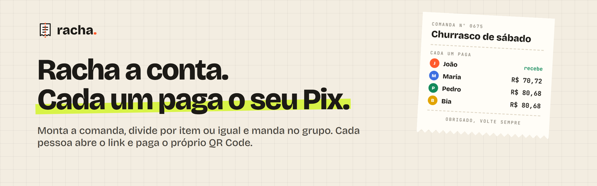
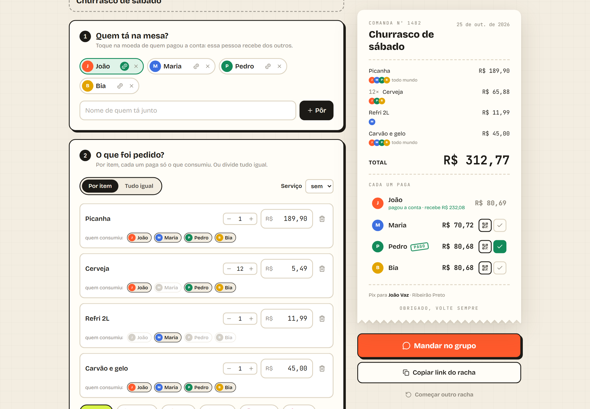
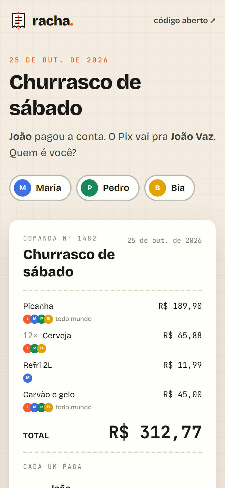
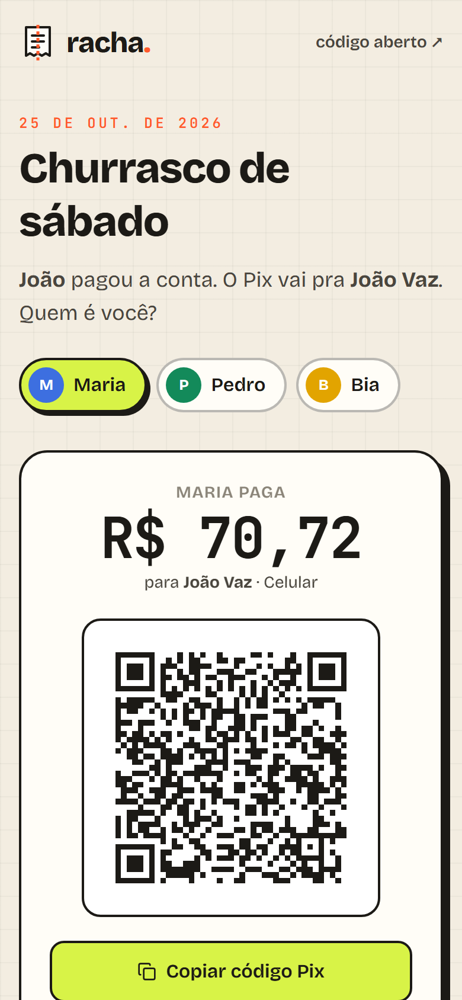
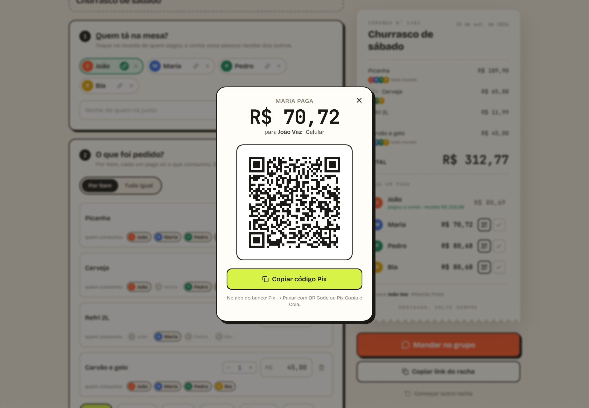

<div align="center">



<br />

[](https://racha-pix-phi.vercel.app)

[](https://github.com/Bleachless/racha-pix/actions/workflows/ci.yml)


**Racha a conta. Cada um paga o seu Pix.**
<br />
Monta a comanda, divide por item ou igual e manda o link no grupo.
<br />
Cada pessoa abre, acha o nome dela e paga o próprio QR Code. **Sem cadastro, sem app, sem servidor.**

</div>

---



## 📱 No celular

<table>
  <tr>
    <td align="center"><br /><sub><b>O link no grupo</b><br />cada um escolhe o nome</sub></td>
    <td align="center"><br /><sub><b>O seu Pix</b><br />QR Code e copia e cola</sub></td>
    <td align="center"><br /><sub><b>No computador</b><br />o Pix de qualquer um, na hora</sub></td>
  </tr>
</table>

## ✨ O que ele faz

- **Divide por item ou igual.** Por item, cada um marca o que consumiu: a cerveja fica só com quem bebeu.
- **Serviço de 10%** (ou 12, 13, 15) proporcional ao que cada um pediu.
- **Fecha no centavo.** A soma das partes é sempre igual ao total, sem centavo sobrando ou faltando.
- **Quem pagou a conta recebe dos outros.** O Pix de cada pessoa já sai com o valor certo.
- **Um link para o grupo.** Pelo WhatsApp ou copiando: a pessoa abre, escolhe o nome e paga.
- **Marca quem já pagou.** Quando todo mundo paga, a comanda ganha o carimbo de *quitado*.

## 🧠 Como funciona por dentro

**O código Pix.** O Racha monta o "Pix copia e cola" estático no padrão BR Code do Banco Central (EMV QRCPS-MPM): chave, valor, nome e cidade de quem recebe, um identificador e o CRC16 no final. Não precisa de banco, API nem conta em lugar nenhum: o pagamento acontece no app do banco de cada um. O teste confere o CRC com o exemplo oficial do manual do Banco Central.

**A chave Pix.** O tipo é reconhecido sozinho (CPF e CNPJ com dígito verificador, celular com +55, e-mail ou chave aleatória) e vai normalizado para dentro do código.

**O link.** O racha inteiro vai compactado (lz-string) depois do `#` do endereço. O navegador não envia essa parte para o servidor: a chave Pix e os nomes ficam só no link e no celular de quem abre.

**A divisão.** Tudo é feito em centavos inteiros, com o método do maior resto para distribuir os centavos que sobram.

## 🧪 Testes

```bash
npm test
```

11 testes cobrem o CRC e os campos do código Pix, a detecção e a validação das chaves, a divisão em centavos (igual, por item, com serviço), a leitura de valores digitados de vários jeitos e o link indo e voltando sem perder nada.

## 🚀 Rodar localmente

```bash
git clone https://github.com/Bleachless/racha-pix.git
cd racha-pix
npm install
npm run dev
```

Abra http://localhost:3000 e clique em **Ver um exemplo pronto**.

## 🗂️ Por dentro

```
src/
├── app/
│   ├── page.tsx         # editor + comanda
│   └── r/page.tsx       # página do link mandado no grupo
├── components/          # editor, comanda, janela do Pix
└── lib/
    ├── pix.ts           # BR Code, CRC16 e chaves
    ├── split.ts         # divisão em centavos
    ├── share.ts         # o racha compactado no link
    ├── charge.ts        # Pix de cada um e texto do WhatsApp
    ├── store.ts         # estado com zustand, salvo no navegador
    └── racha.test.ts    # testes
```

## 🛣️ Próximos passos

- [ ] Ler a nota fiscal (QR Code da NFC-e) e já trazer os itens
- [ ] Vários pagadores no mesmo racha
- [ ] Histórico dos rachas anteriores

---

<div align="center">

Feito por **[João Vaz](https://github.com/Bleachless)**, desenvolvedor full stack que trabalha no setor financeiro.
<br />
Veja também o **[Rende Mais](https://github.com/Bleachless/rende-mais)** 📈 e o **[Cofrinho](https://github.com/Bleachless/cofrinho)** 🐷

<sub>Pix é uma marca do Banco Central do Brasil. O Racha não tem ligação com o Banco Central: só gera o código no padrão público.</sub>

</div>
